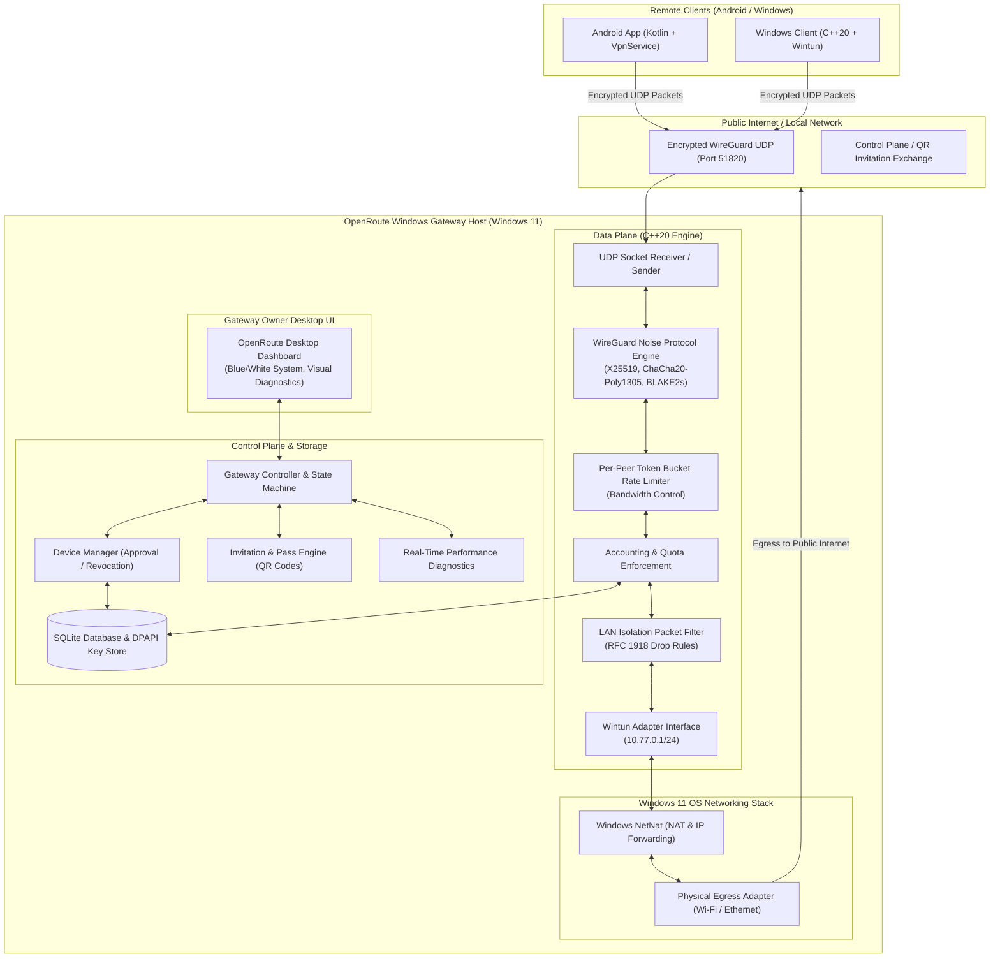

# OpenRoute — Architectural Specification

## 1. System Topology & Architecture Overview

OpenRoute is organized around five major subsystems:

---

## 2. Subsystem Breakdown

### 2.1 Gateway Engine & Data Plane (`core/tunnel`, `core/gateway`, `core/bandwidth`)
1. **`WintunAdapter`**:
   - Manages lifecycle of the virtual TUN interface (`openroute0`).
   - Configures IPv4 address (`10.77.0.1`), subnet mask (`255.255.255.0`), and MTU (`1420` bytes to account for WireGuard headers).
   - Reads unencrypted IP packets from OS and dispatches encrypted WireGuard UDP packets to peers; decrypts inbound WireGuard UDP packets and writes to Wintun.
2. **`WireGuardEngine`**:
   - Implements standard WireGuard protocol packets:
     - Type 1: Handshake Initiation (148 bytes)
     - Type 2: Handshake Response (92 bytes)
     - Type 3: Cookie Reply (64 bytes)
     - Type 4: Encapsulated Transport Data (32+ bytes)
   - Performs key rotation every 120 seconds or after $2^{64}-1$ packets.
   - Manages session state machine (`UNAUTHENTICATED`, `HANDSHAKING`, `ESTABLISHED`, `REKEYING`, `EXPIRED`).
3. **`BandwidthLimiter`**:
   - High-precision token bucket algorithm per active peer.
   - Configurable tokens: `bytes_per_second` (ingress rate) and `bytes_per_second` (egress rate).
   - Implements fair queueing; buffers burst traffic up to burst capacity and throttles exceeding packets without starving peers.
4. **`QuotaManager`**:
   - Real-time atomic counters for uploaded and downloaded bytes per device.
   - Automatically shifts peer status to `SUSPENDED_QUOTA_EXCEEDED` when daily/monthly threshold is reached.
   - Periodically checkpoints usage to SQLite storage.
5. **`LanIsolationFilter`**:
   - Inspects destination IP addresses of all forwarded packets leaving the tunnel.
   - Default policy: Drops all traffic destined for private local networks (`192.168.0.0/16`, `10.0.0.0/8`, `172.16.0.0/12`), unless explicitly authorized. Prevents guest devices from snooping or accessing home NAS, routers, or internal services.

---

### 2.2 Control Plane & Policy Engine (`core/device`, `core/policy`, `core/security`)
1. **`DeviceManager`**:
   - Enforces 5-state lifecycle for every registered peer:
     - `PENDING_APPROVAL`: Device scanned invitation and requested access; awaiting owner action.
     - `APPROVED`: Device authorized; key pair enrolled in data plane.
     - `PAUSED`: Device temporarily barred from sending traffic without deleting configuration.
     - `REVOKED`: Key permanently blacklisted; sessions dropped immediately.
     - `EXPIRED`: Guest pass duration lapsed.
2. **`InvitationEngine`**:
   - Generates cryptographically secure 256-bit invitation tokens.
   - Encodes invitation metadata into QR code payloads and shareable URLs (`openroute://invite?token=...&gw=...`).
   - Supports single-use and multi-use passes with explicit expiration timers (e.g. 2 hours, 24 hours, 7 days).
3. **`DiagnosticsEngine`**:
   - Tracks real-time network health:
     - Realized throughput (upload/download bitrates).
     - Round-Trip Time (RTT) / latency calculation via keepalive pings.
     - Packet loss ratio ($packets\_sent - packets\_acked / packets\_sent$).
     - Host resource metrics (CPU and Memory consumption).

---

### 2.3 Storage & Key Management (`core/storage`, `core/security`)
1. **Database Schema**:
   - SQLite3 database operating in Write-Ahead Logging (WAL) mode for concurrency and low overhead.
   - Structured relational schema for users, gateways, registered devices, invitations, quota rules, and audit logs.
2. **Credential Protection**:
   - Gateway private keys and preshared keys are encrypted at rest using Windows DPAPI (`CryptProtectData`).
   - Plaintext private keys are never persisted to disk or logged to files.

---

### 2.4 User Interface Subsystem (`apps/windows`)
- Clean desktop interface adhering to the specified blue & white design language:
  - Primary blue: `#2563EB`
  - Deep blue: `#1D4ED8`
  - Background: `#F8FAFC`
  - Card/Container: `#FFFFFF`
  - Text Primary: `#0F172A`
  - Status Success: `#16A34A`, Warning: `#D97706`, Error: `#DC2626`
- Live dashboard displaying:
  - Gateway status indicator (Online / Offline / Degraded)
  - Active peer count, realtime bandwidth graph
  - One-click device approval and revocation
  - QR Code display for quick guest onboarding
