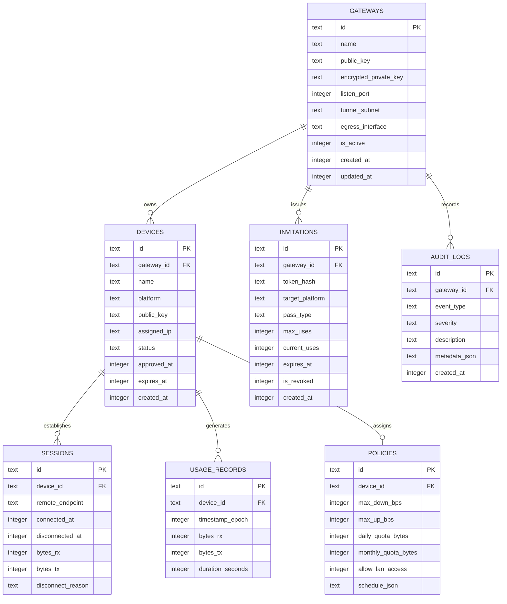

# OpenRoute — Database Architecture & Data Model

## 1. Overview & Technology Selection

- **Database Engine**: SQLite 3 (Amalgamation, embedded in-process).
- **Storage Path**: `%APPDATA%\OpenRoute\openroute.db` (Windows) or `/data/data/org.openroute/databases/openroute.db` (Android).
- **Concurrency Mode**: Write-Ahead Logging (`PRAGMA journal_mode=WAL;`), synchronous normal (`PRAGMA synchronous=NORMAL;`), foreign keys enabled (`PRAGMA foreign_keys=ON;`).

---

## 2. Entity-Relationship Schema



---

## 3. SQL DDL Specification

```sql
-- Schema Version 1

CREATE TABLE IF NOT EXISTS schema_migrations (
    version INTEGER PRIMARY KEY,
    applied_at INTEGER NOT NULL
);

CREATE TABLE IF NOT EXISTS gateways (
    id TEXT PRIMARY KEY,
    name TEXT NOT NULL,
    public_key TEXT NOT NULL UNIQUE,
    encrypted_private_key BLOB NOT NULL,
    listen_port INTEGER NOT NULL DEFAULT 51820,
    tunnel_subnet TEXT NOT NULL DEFAULT '10.77.0.0/24',
    egress_interface TEXT NOT NULL DEFAULT 'Wi-Fi',
    is_active INTEGER NOT NULL DEFAULT 1,
    created_at INTEGER NOT NULL,
    updated_at INTEGER NOT NULL
);

CREATE TABLE IF NOT EXISTS devices (
    id TEXT PRIMARY KEY,
    gateway_id TEXT NOT NULL REFERENCES gateways(id) ON DELETE CASCADE,
    name TEXT NOT NULL,
    platform TEXT NOT NULL, -- 'android', 'windows', etc.
    public_key TEXT NOT NULL UNIQUE,
    assigned_ip TEXT NOT NULL UNIQUE,
    status TEXT NOT NULL DEFAULT 'PENDING_APPROVAL', -- 'PENDING_APPROVAL', 'APPROVED', 'PAUSED', 'REVOKED', 'EXPIRED'
    approved_at INTEGER,
    expires_at INTEGER,
    created_at INTEGER NOT NULL
);

CREATE INDEX IF NOT EXISTS idx_devices_gateway ON devices(gateway_id);
CREATE INDEX IF NOT EXISTS idx_devices_public_key ON devices(public_key);
CREATE INDEX IF NOT EXISTS idx_devices_status ON devices(status);

CREATE TABLE IF NOT EXISTS policies (
    id TEXT PRIMARY KEY,
    device_id TEXT NOT NULL UNIQUE REFERENCES devices(id) ON DELETE CASCADE,
    max_down_bps INTEGER NOT NULL DEFAULT 0, -- 0 = unlimited
    max_up_bps INTEGER NOT NULL DEFAULT 0,   -- 0 = unlimited
    daily_quota_bytes INTEGER NOT NULL DEFAULT 0, -- 0 = unlimited
    monthly_quota_bytes INTEGER NOT NULL DEFAULT 0,
    allow_lan_access INTEGER NOT NULL DEFAULT 0,
    schedule_json TEXT
);

CREATE TABLE IF NOT EXISTS invitations (
    id TEXT PRIMARY KEY,
    gateway_id TEXT NOT NULL REFERENCES gateways(id) ON DELETE CASCADE,
    token_hash TEXT NOT NULL UNIQUE,
    target_platform TEXT NOT NULL,
    pass_type TEXT NOT NULL DEFAULT 'TEMPORARY_24H',
    max_uses INTEGER NOT NULL DEFAULT 1,
    current_uses INTEGER NOT NULL DEFAULT 0,
    expires_at INTEGER NOT NULL,
    is_revoked INTEGER NOT NULL DEFAULT 0,
    created_at INTEGER NOT NULL
);

CREATE INDEX IF NOT EXISTS idx_invitations_token_hash ON invitations(token_hash);

CREATE TABLE IF NOT EXISTS usage_records (
    id TEXT PRIMARY KEY,
    device_id TEXT NOT NULL REFERENCES devices(id) ON DELETE CASCADE,
    timestamp_epoch INTEGER NOT NULL,
    bytes_rx INTEGER NOT NULL DEFAULT 0,
    bytes_tx INTEGER NOT NULL DEFAULT 0,
    duration_seconds INTEGER NOT NULL DEFAULT 0
);

CREATE INDEX IF NOT EXISTS idx_usage_device_time ON usage_records(device_id, timestamp_epoch);

CREATE TABLE IF NOT EXISTS audit_logs (
    id TEXT PRIMARY KEY,
    gateway_id TEXT NOT NULL REFERENCES gateways(id) ON DELETE CASCADE,
    event_type TEXT NOT NULL,
    severity TEXT NOT NULL DEFAULT 'INFO',
    description TEXT NOT NULL,
    metadata_json TEXT,
    created_at INTEGER NOT NULL
);

CREATE INDEX IF NOT EXISTS idx_audit_time ON audit_logs(created_at);
```
